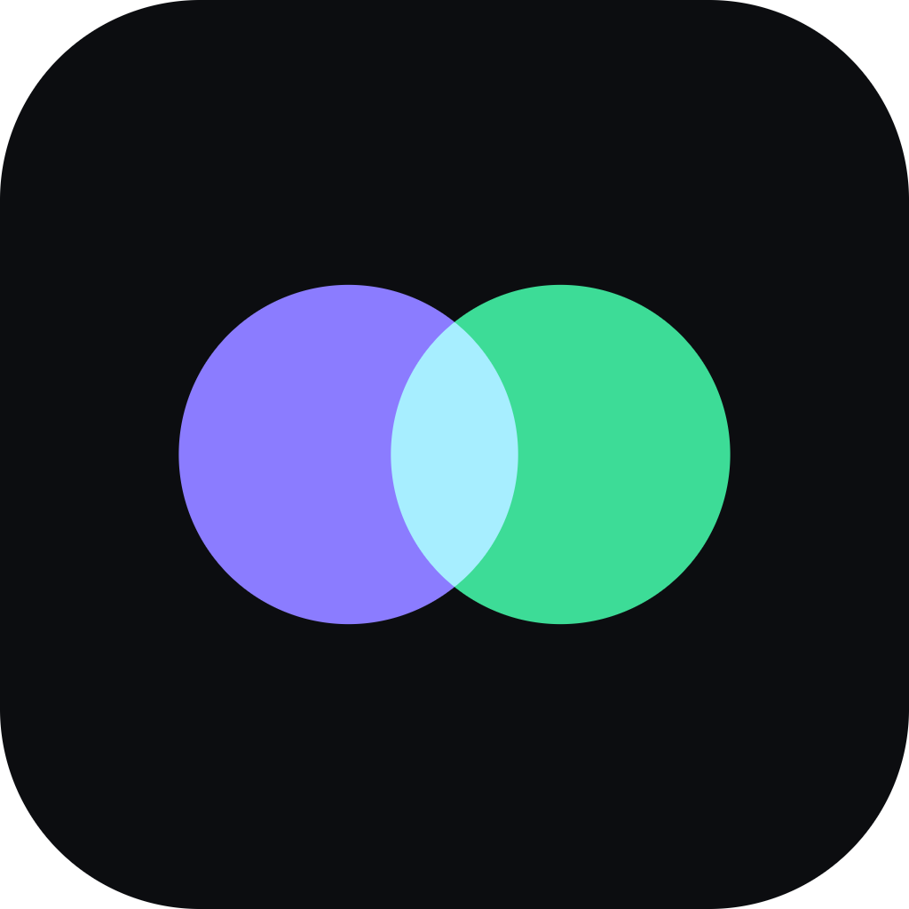
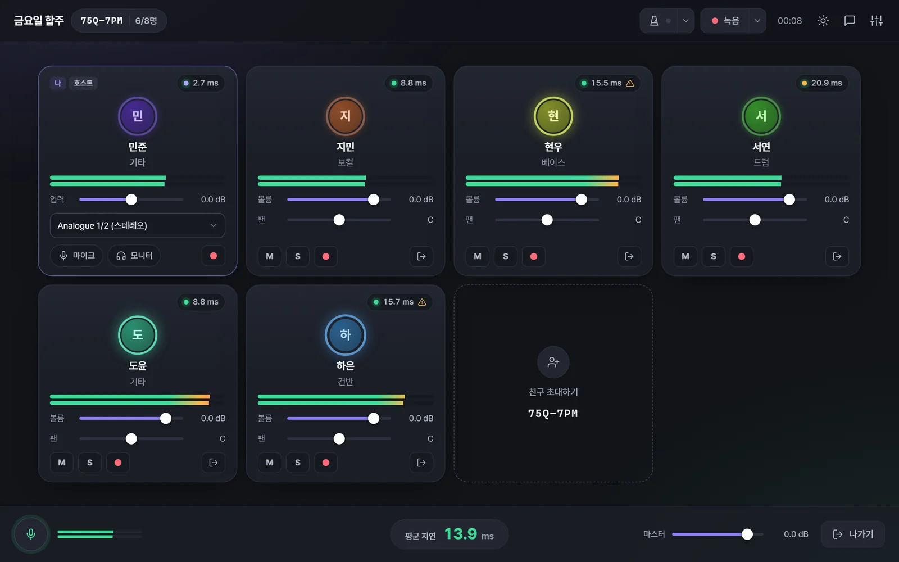

<div align="center">



# gachi

**멀리 있어도, 같이 합주해요**

인터넷으로 함께 연주하는 합주 앱이에요.<br>
소리는 서버를 거치지 않고 방에 있는 사람들끼리 직접 오가요.

[](https://github.com/aape133/gachi/releases/latest)
[](https://github.com/aape133/gachi/releases/latest)
[](LICENSE)

**[⬇ 내려받기](https://github.com/aape133/gachi/releases/latest)** &nbsp;·&nbsp;
[홈페이지](https://gachi.band) &nbsp;·&nbsp;
[English](https://gachi.band/en/) &nbsp;·&nbsp;
[日本語](https://gachi.band/ja/)

<br>

<picture>
  <source media="(prefers-color-scheme: dark)" srcset="worker/public/img/room-dark.webp">
  
</picture>

</div>

<br>

## ✨ 한눈에

<table>
  <tr>
    <td width="50%" valign="top">
      <h3>🔗 서버 없이 직접 연결</h3>
      소리와 채팅은 사람들끼리 직접(P2P) 오가요. 압축하지 않은 소리를 그대로 보내서 코덱 지연이 없어요.
    </td>
    <td width="50%" valign="top">
      <h3>👥 최대 16명</h3>
      6자리 코드, 초대 링크, QR 코드 하나로 들어와요. 방장이 나가도 다음 사람이 이어받아요.
    </td>
  </tr>
  <tr>
    <td valign="top">
      <h3>🎚 DAW와 함께</h3>
      VST3 플러그인을 트랙 끝에 넣으면 이펙트를 거친 소리로 합주하고, 다른 사람 소리가 그 자리에서 섞여 나와요.
    </td>
    <td valign="top">
      <h3>⏺ 트랙별 녹음</h3>
      사람마다 따로 WAV·FLAC 파일로 남기고, 내가 들은 그대로의 믹스도 함께 저장해요.
    </td>
  </tr>
  <tr>
    <td valign="top">
      <h3>🔒 종단 간 암호화</h3>
      소리와 채팅은 방 사람들만 열어 볼 수 있어요. 방 비밀번호는 서버에 보내지 않아요.
    </td>
    <td valign="top">
      <h3>🌐 한국어 · English · 日本語</h3>
      처음에는 Windows 언어를 따르고, 설정에서 언제든 바꿀 수 있어요.
    </td>
  </tr>
</table>

## 🚀 시작하기

| | |
|:-:|---|
| **1** | **[Releases](https://github.com/aape133/gachi/releases/latest)** 에서 `gachi_버전_x64-setup.exe`를 받아 실행해요.<br><sub>코드 서명이 없어서 "Windows의 PC 보호" 창이 뜨면 **추가 정보 → 실행**을 눌러요.</sub> |
| **2** | 이름을 정하고 **방 만들기**를 눌러요. 코드나 초대 링크를 친구에게 보내요. |
| **3** | 친구가 **참여하기**에 코드를 넣으면 바로 서로의 소리가 들려요. |

### 필요한 것

- Windows 10 / 11 (64비트)
- ASIO 드라이버가 있는 오디오 인터페이스<br><sub>VST 연결 방식에서는 DAW가 장치를 다루므로 앱에는 필요 없어요.</sub>
- 유선 인터넷을 권해요. 사람이 많은 방은 업로드 속도가 넉넉해야 해요.<br><sub>16명 방에서 24비트 스테레오로 보내면 약 41 Mbps, 16비트면 약 29 Mbps가 필요해요.</sub>

### 🎚 DAW와 같이 쓰기

설정 → 오디오 → 연결 방식에서 **VST 연결**을 고르고, 보낼 트랙(또는 그룹 트랙)의 맨 끝에 gachi 플러그인을 넣어요. 플러그인은 설치 파일에 들어 있지 않아서 따로 받아요.

1. [Releases](https://github.com/aape133/gachi/releases/latest)에서 `gachi_버전_vst3.zip`을 받아 압축을 풀어요.
2. 안에 있는 `gachi.vst3` 폴더를 통째로 DAW의 VST3 폴더(보통 `C:\Program Files\Common Files\VST3`)에 넣어요. 이미 있으면 덮어써요.
3. DAW에서 플러그인을 다시 찾아요.

> [!TIP]
> 앱과 플러그인은 같은 버전으로 맞춰 쓰는 것이 좋아요.

## 🎛 기능

<details>
<summary><b>방</b> — 코드·링크·QR로 입장, 방장 넘겨받기, 같은 공유기의 방 목록</summary>
<br>

- 6자리 코드, 초대 링크, QR 코드로 들어와요. 초대 링크 페이지는 받는 사람의 브라우저 언어(한국어·English·日本語)로 나와요.
- 방 크기는 2명부터 16명까지예요. 만들 때 고르고, 방 안에서 방장이 바꿀 수 있어요.
- 8명보다 큰 방은 모두가 0.2.0 이상이어야 해요. 예전 버전은 들어오지 못하고, 방 안에 예전 버전이 있으면 8명보다 크게 늘릴 수 없어요.
- 사람이 많을수록 업로드가 많이 필요해요(모두가 모두에게 직접 보내요). 9명부터는 24비트로 보내고 있으면 16비트로 바꿔 보라고 한 번 알려 줘요. 자동으로 바꾸지는 않아요.
- 사람 카드는 인원수와 창 크기에 맞춰 큰 카드, 중간 카드, 작은 카드로 저절로 바뀌어요.
- 방 비밀번호, 입장 코드 켜고 끄기, 새 코드 만들기(예전 코드는 못 쓰게 돼요).
- 입장 코드는 켠 지 12시간이 지나면 저절로 꺼져요. 합주는 그대로 계속되고, 방장이 다시 켤 수 있어요.
- 방장은 사람을 내보낼 수 있고, 내보낸 사람은 다시 들어오지 못해요.
- 방장이 나가면 다음 사람이 자동으로 방장을 이어받아요.
- 같은 공유기에 있는 사람에게는 방이 목록에 떠서 코드 없이 들어올 수 있어요(끌 수 있어요).
- 방에서 잠깐 나왔다면 첫 화면의 "최근 들어간 방"을 눌러 바로 다시 들어가요. 앱을 켜 둔 동안에만 기억하고, 끄면 지워져요.
- 상단의 시간은 방이 열린 뒤부터의 시간이에요. 모두에게 똑같이 보이고, 방장이 바뀌어도 이어져요.

</details>

<details>
<summary><b>소리</b> — ASIO, 무압축 PCM, 스스로 맞추는 지터 버퍼</summary>
<br>

- ASIO 입출력, 무압축 PCM(16비트 또는 24비트). 처음에는 16비트이고, 설정에서 24비트로 바꿀 수 있어요.
- 패킷 크기는 장치 버퍼 크기에 맞춰 자동으로 정해져요(64샘플까지). 16 / 32 / 64 중에 직접 고를 수도 있어요.
- 지터 버퍼가 연결 상태에 맞춰 스스로 조절돼요. 빠르게 / 균형 / 안정 중에 고르거나 직접 정할 수 있어요.
- 패킷이 빠지면 앞 소리를 이어 붙여 메우고(길게 비면 "삐" 소리가 나지 않게 여러 주기를 번갈아 써요), 몰려서 도착하면 버리지 않고 살짝 빠르게 재생해 따라잡아요.
- 사람마다 조금씩 다른 사운드카드 클럭을 맞춰서, 오래 합주해도 지연이 늘거나 끊기지 않아요.
- 샘플레이트가 다른 사람끼리(44.1 kHz와 48 kHz)도 변환해서 들려줘요.
- 손실이 생기는 연결에는 패킷을 한 번 더 보내요. 한 번에 많이 잃을 때뿐 아니라, Wi-Fi처럼 조금씩 자주 잃을 때도 켜져요.
- 여러 사람 소리가 합쳐져 넘칠 때는 리미터가 막아요.

</details>

<details>
<summary><b>믹서</b> — 사람별 볼륨·팬·뮤트·솔로, 입력 채널 고르기</summary>
<br>

- 사람별 볼륨, 팬, 뮤트, 솔로와 마스터 볼륨.
- 슬라이더는 한 번 클릭한 뒤 마우스 휠로도 조절해요(Shift를 누르면 더 세밀하게). 더블클릭하면 기본값으로 돌아가요.
- 입력 게인, 입력 채널 선택(모노, 스테레오, 마이크 + 스테레오 섞기), 내 소리 모니터.
- 사람별 레벨 미터와 입력 채널별 미터.

</details>

<details>
<summary><b>지연과 연결 상태</b> — 지연이 어디서 생기는지 한눈에</summary>
<br>

- 사람별로 지연이 어디서 생기는지(상대 입력, 네트워크, 지터 버퍼, 내 출력) 나눠서 보여줘요.
- 연결 경로(IPv4 / IPv6), 왕복 시간, 패킷 손실, 유선 / Wi-Fi 여부, 상대가 보내는 소리의 형식(비트 수, 샘플레이트, 모노 / 스테레오, 패킷 크기).
- 설정의 네트워크 점검: 직접 연결이 쉬운 환경인지, 공유기가 포트를 열어 줄 수 있는지.

</details>

<details>
<summary><b>연결</b> — 직접 연결, 자동 포트 열기, 끊겨도 다시 이어 붙기</summary>
<br>

- 직접 연결만 써요. LAN, 공인 IPv4, IPv6, VPN 어댑터 주소로 동시에 시도해서 가장 직접적인 길을 골라요.
- 공유기에 UPnP 또는 NAT-PMP가 있으면 포트를 자동으로 열어요.
- 공유기에 UPnP가 없거나 꺼져 있으면 설정 → 네트워크 → 고급 설정에서 **직접 연결 포트 고정**을 켜고(기본 24620), 공유기 관리 페이지에서 그 **UDP** 포트를 이 PC의 주소로 포워딩해요. 같은 공유기의 PC마다 다른 번호를 써야 해요. 회사·학교망이나 통신사 공유 주소 뒤에서는 포워딩할 수 없어요.
- 네트워크가 바뀌면(Wi-Fi ↔ 유선, IP 변경) 다시 이어 붙고, 내 인터넷이 끊겼다 돌아오면 방에 자동으로 다시 들어가요.
- 누군가와 직접 연결이 안 되면 이유와 해결 방법을 알려 줘요(모바일 핫스팟이나 회사망, UDP가 막힌 네트워크, PC 방화벽 등).

</details>

<details>
<summary><b>보안</b> — 종단 간 암호화, 봉인된 입장 요청, 보안 확인 코드</summary>
<br>

- 소리와 채팅은 종단 간 암호화돼요(X25519 키 교환, AES-256-GCM 또는 ChaCha20-Poly1305).
- 입장 요청은 방장만 열 수 있게 봉인돼서, 연결 서버는 내용과 비밀번호를 볼 수 없어요.
- 방의 12자리 보안 확인 코드가 모두의 화면에서 같으면 중간에 엿듣는 사람이 없는 거예요.
- 방장이 알려 주는 방 정보와 멤버 목록도 정해진 범위 안에서만 받아들이고, 한 사람이 채팅을 쏟아 내면 넘치는 만큼은 버려요.
- 누가 방을 나가거나 내보내지면 입장 코드의 열쇠를 새로 바꿔요. 나간 사람은 그 코드를 가져가거나 새로 들어오는 사람을 가로챌 수 없어요.
- 방 비밀번호를 10분 안에 5번 틀린 사람은 그 방에 10분 동안 들어갈 수 없어요. 다른 사람은 그대로 들어올 수 있어요.

</details>

<details>
<summary><b>VST3 플러그인</b> — DAW에 지연을 더하지 않고 합주</summary>
<br>

- DAW의 트랙이나 그룹 끝에 넣으면 그 소리가 방으로 가고, 다른 사람 소리가 그 자리에서 섞여 나와요.
- DAW에 추가 지연을 만들지 않아요(같은 블록 안에서 주고받아요).
- 모노 트랙과 스테레오 트랙을 모두 지원해요. 파일로 내보낼 때는 트랙 소리만 통과시켜요.

</details>

<details>
<summary><b>메트로놈과 녹음</b> — 모두 같은 박자, 사람별 파일</summary>
<br>

- 방 전체가 같은 박자로 듣는 메트로놈(BPM, 박자, 켤 때 1~2마디 카운트인). 상단 메트로놈 버튼으로 켜고 끄고, 옆 화살표에서 설정해요.
- 트랙별 녹음: 사람마다 따로 파일로 저장해요. 카드의 녹음 버튼(●)을 끄면 그 사람은 빼고 녹음해요(내 카드에도 있어요).
- 녹음 형식은 녹음 버튼 옆 화살표에서 골라요: WAV(16bit가 기본, 24bit, 32bit float) 또는 FLAC(무손실 압축, 16bit·24bit). 모노로 보내는 사람은 모노 파일로 저장돼요.
- 모두의 소리를 내가 듣는 그대로 섞은 "믹스" 파일도 같이 저장할 수 있어요(메트로놈 소리는 들어가지 않아요).
- 디스크가 가득 차는 등 녹음을 쓸 수 없게 되면 바로 알려 주고 멈춰요. 그때까지 녹음한 파일은 남아요.
- 녹음 중에도 켜고 끌 수 있어요. 꺼 둔 구간은 무음으로 채워져서 파일끼리 시간이 맞고, 처음부터 끝까지 꺼 둔 사람은 파일이 생기지 않아요.
- 녹음은 `문서\gachi\녹음\2026-11-16 0903 금요일 합주 [2N4FW8]` 같은 폴더에 `금요일 합주 0903 - 01 지민 (보컬).wav` 같은 이름으로 들어가요(날짜, 시각, 방 이름, 입장 코드). 영어·일본어 화면에서 처음 녹음하면 폴더 이름은 `Recordings`·`録音`이에요.
- 아주 긴 WAV 녹음은 트랙마다 `… - 2.wav`처럼 여러 파일로 이어져요(한 파일이 4 GB를 넘지 않게: 48 kHz 16bit에서 5시간 33분마다).

</details>

<details>
<summary><b>그 밖에</b> — 채팅, 색, 테마, 언어, 새 버전 알림</summary>
<br>

- 채팅, 사람마다 고르는 색(16가지), 라이트 / 다크 테마.
- 한국어·English·日本語 화면. 버튼 글자가 그 언어로 한 줄에 다 들어가지 않으면 알아서 줄이거나 아이콘만 보여 줘요.
- 새 버전이 나오면 첫 화면에서 알려 줘요.
- 상대 소리가 내 마이크로 되돌아가면 알려 줘요.

</details>

## 🛡 백신 경고가 뜰 때

설치 파일에 코드 서명이 없어서, 일부 백신이나 Windows Defender가 gachi를 의심스러운 파일로 잘못 판정할 수 있어요(오탐). 이름에 `ml`이 들어간 판정이 대표적인데, 알려진 악성코드와 일치했다는 뜻이 아니라 "처음 보는 서명 없는 프로그램"이라는 뜻에 가까워요.

gachi는 사람들끼리 직접 연결하려고 네트워크 주소를 여러 곳으로 시도하고, 마이크 소리를 보내요. 이런 동작이 겉보기에 의심을 살 수 있어요.

- 소스가 모두 이 저장소에 공개돼 있어서 직접 확인할 수 있어요.
- 설치 파일과 플러그인은 이 저장소의 Releases에서만 받으세요.
- 오탐으로 보이면 그 백신 회사에 오탐 신고를 할 수 있어요.

## 🔐 개인정보

- 소리와 채팅은 서버를 거치지 않아요.
- 연결 서버는 누가 접속했는지(인터넷 주소 포함)를 저장하지 않아요. 다만 접속하는 순간에는 연결 서버와 그 운영자, 서버를 호스팅하는 Cloudflare가 인터넷 주소(IP)를 볼 수 있어요.
- 앱 화면에는 다른 사람의 IP가 나오지 않아요. 다만 소리를 서로에게 바로 보내려면 컴퓨터끼리 상대의 주소를 알아야 해서, 네트워크 분석 도구를 쓰면 같은 방 사람의 IP를 확인할 수는 있어요.
- 로그 파일에는 이 앱의 활동만 남아요. 공인 IP는 앞 두 자리만 남기고(`203.0.x.x`), 이름, 방 비밀번호, 채팅 내용은 남기지 않아요.
- 프로그램을 켤 때 새 버전이 나왔는지 GitHub에 한 번 물어봐요(설정 → 일반에서 끌 수 있어요). 이때 GitHub가 IP를 볼 수 있어요. 내려받기와 설치는 스스로 하지 않아요.

## 🛠 소스에서 빌드하기

이 저장소에 앱, VST3 플러그인, 연결 서버의 소스와 빌드·설치 스크립트가 모두 들어 있어요. 릴리스마다 같은 이름의 태그(`v0.6.0` 등)가 그 릴리스를 만든 소스예요.

<details>
<summary><b>준비물</b> (Windows 10 / 11, 64비트)</summary>
<br>

- [Rust](https://rustup.rs) (stable, MSVC 도구 모음)
- Visual Studio 또는 Build Tools의 **C++ 데스크톱 개발**과 **C++ Clang 도구** 구성 요소
  - ASIO 바인딩을 만들 때 libclang을 써요. 경로는 [.cargo/config.toml](.cargo/config.toml)에 적혀 있고, 다른 곳에 있으면 `LIBCLANG_PATH` 환경 변수로 알려 주세요.
- [Node.js](https://nodejs.org) (설치 파일을 만들 때와 연결 서버에 필요해요)
- Steinberg ASIO SDK는 처음 빌드할 때 Steinberg 사이트에서 자동으로 내려받아요. 이 저장소에는 들어 있지 않아요.

</details>

**앱 실행**

```bash
cargo run -p gachi --release
```

ASIO 없이 빌드하려면 `--no-default-features`를 붙여요.

**설치 파일과 VST3 플러그인**

```bash
cd app
npm install               # 처음 한 번 (Tauri CLI)
npm run build:installer
```

- 설치 파일: `target/release/bundle/nsis/gachi_버전_x64-setup.exe`
- 플러그인: `target/release/vst3/gachi.vst3` (폴더)와 `target/release/vst3/gachi_버전_vst3.zip`
- 설치 스크립트는 [app/installer.nsi](app/installer.nsi)와 [app/installer-hooks.nsh](app/installer-hooks.nsh), 플러그인 묶음 스크립트는 [crates/plugin/bundle.ps1](crates/plugin/bundle.ps1)이에요. 플러그인만 만들려면:

```bash
powershell -ExecutionPolicy Bypass -File crates/plugin/bundle.ps1
```

**테스트**

```bash
cargo test --workspace
```

**연결 서버** — 방에 들어갈 때만 쓰는 작은 서버(Cloudflare Worker)예요. gachi.band의 소개 페이지도 같이 내보내요. 직접 띄우거나 배포하는 방법은 [worker/README.md](worker/README.md)에 있어요. 앱이 다른 서버를 쓰게 하려면 `GACHI_SERVER` 환경 변수를 주거나 `app/src/settings.rs`의 `DEFAULT_SERVER`를 바꿔 빌드해요.

## 🌐 번역

앱의 모든 문구는 [`ui/locales/`](ui/locales)의 언어 파일에 있어요. 언어마다 파일이 하나씩 있고(`en-US.json`, `ko-KR.json`, `ja-JP.json`), 영어(`en-US`)가 기준이에요. 다른 언어 파일에 없는 문구는 영어로 나와요.

새 언어를 더하려면:

1. `ui/locales/en-US.json`을 복사해 언어 코드로 이름을 바꾸고(예: `fr-FR.json`), 값만 번역해요. 키와 `{name}` 같은 자리 표시는 그대로 둬요.
2. `"language.name"`에는 그 언어로 쓴 언어 이름을 적어요(예: `"Français"`).
3. `ui/locales/languages.json` 목록에 코드를 더해요.
4. `cargo test -p gachi-lang`으로 빠진 문구나 자리 표시가 다른 곳이 없는지 확인해요.

다시 빌드하면 설정 → 일반의 언어 목록에 저절로 나타나요.

## 📄 라이선스

gachi는 자유 소프트웨어예요. **GNU General Public License 버전 3**(GPLv3)에 따라 쓰고, 고치고, 다시 배포할 수 있어요. 전문은 [LICENSE](LICENSE)에 있어요. 보증은 없어요.

- 앱은 Steinberg ASIO SDK를 그 SDK의 GPLv3 선택지로 써서 빌드돼요. SDK 자체는 이 저장소에 없어요.
- 녹음 파일은 WAV는 hound, FLAC은 flacenc 라이브러리로 써요(둘 다 Apache-2.0). FLAC 형식 자체는 누구나 자유롭게 쓸 수 있어요.
- 같이 쓰는 오픈소스 라이브러리는 [THIRD-PARTY-LICENSES.md](THIRD-PARTY-LICENSES.md)에, 글꼴 Pretendard·Pretendard JP의 라이선스(SIL OFL 1.1)는 [ui/fonts/LICENSE.txt](ui/fonts/LICENSE.txt)에 있어요.

<br>

<div align="center">


&nbsp;&nbsp;


<sub>ASIO® is a registered trademark of Steinberg Media Technologies GmbH.<br>VST® is a registered trademark of Steinberg Media Technologies GmbH.</sub>

</div>
